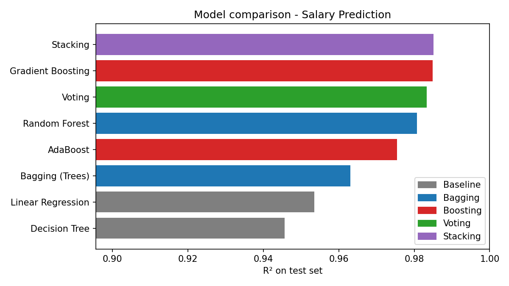
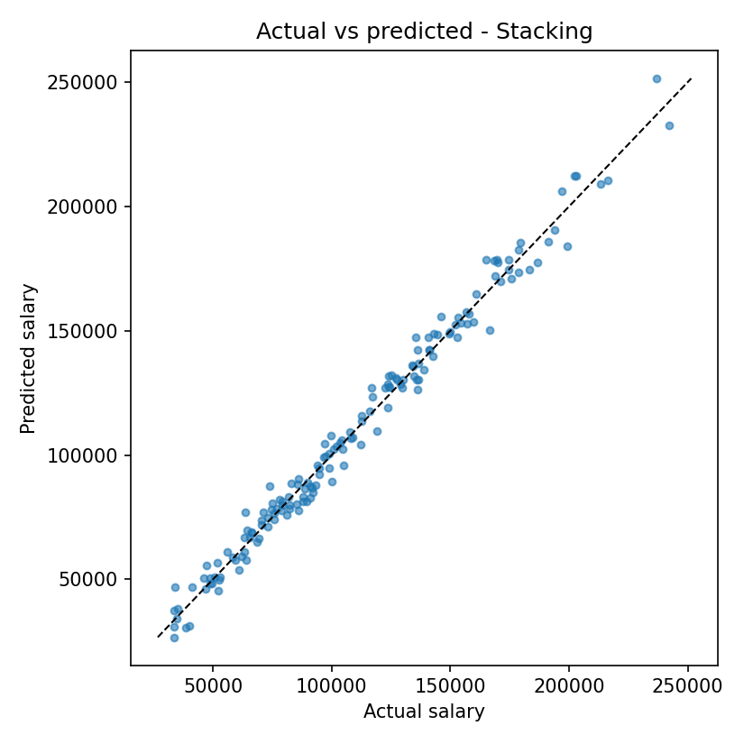

# Salary Prediction using Ensemble Learning

> **Mini Project – Extension** | Predicting employee salary with **Bagging, Boosting, Voting and Stacking**
> **By – Akshata Laxman Powar**

  

## 1. Overview

This project extends the earlier **Salary Prediction** mini project (Linear Regression, Decision Tree, Random Forest). It predicts the **annual salary** of an employee from job-related details and compares the four main families of **ensemble learning** against simple baseline models.

| | |
|---|---|
| **Problem** | Predict an employee's annual salary from job-related information |
| **Why it matters** | Supports salary planning, budgeting and data-driven HR decisions |
| **Output** | Predicted annual salary + comparison of 8 regression models |
| **Customers** | Organizations, HR teams, employees |

## 2. SIPOC

| Supplier | Input | Process | Output | Customer |
|---|---|---|---|---|
| Employee / HR salary dataset (CSV) | Experience, education, job title, age, gender, location | Clean → Encode → Split → Train baselines + ensembles → Compare | Predicted annual salary + best model | Organizations, HR teams, employees |

## 3. Dataset

Synthetic dataset generated in Python (`data.py`): **800 employees**, saved to `salary.csv`, split **80% train / 20% test**. No missing values.

| Column | Type | Description |
|---|---|---|
| `employee_id` | key | Unique ID (not used for training) |
| `years_experience` | numeric | 0–20 years |
| `age` | numeric | 22–60 |
| `education_level` | categorical | Bachelors / Masters / PhD |
| `job_title` | categorical | Analyst / Developer / Data Scientist / Manager / Director |
| `gender` | categorical | Male / Female |
| `location` | categorical | Tier-1 / Tier-2 / Tier-3 City |
| **`salary`** | **target** | Annual salary (continuous) |

**Why the data is non-linear:** salary includes a *job title × experience* interaction (a Director gains more per year than an Analyst) and a *seniority bonus* after 10 years. This gives ensembles real structure to learn, instead of a plain straight-line relationship. This was done on purpose and results should be read with that in mind.

## 4. Ensemble Methods Used

| Family | Idea | Models in this project |
|---|---|---|
| **Baseline** | Single model, for reference | Linear Regression, Decision Tree |
| **Bagging** | Train many models on random bootstrap samples, average predictions → lower variance | Bagging (Trees), Random Forest |
| **Boosting** | Train models one after another, each correcting the previous errors → lower bias | AdaBoost, Gradient Boosting |
| **Voting** | Combine *different* model types and average their predictions | Linear Regression + Random Forest + Gradient Boosting |
| **Stacking** | A meta-model (Linear Regression) learns how best to combine base models | Base: Decision Tree, Random Forest, Gradient Boosting |

## 5. Project Structure

```
salary-prediction-ensemble/        (all files in one flat folder)
├── main.py                        # run full comparison
├── predict.py                     # predict salary for a new employee
├── config.py                      # paths, seed, feature lists
├── data.py                        # dataset generation, loading, split
├── models.py                      # baselines + 4 ensemble families
├── evaluate.py                    # training, metrics, plots
├── test_pipeline.py               # basic pytest checks
├── salary.csv                     # generated dataset
├── metrics.csv                    # model comparison table
├── model_comparison.png           # R² bar chart by family
├── best_actual_vs_predicted.png   # actual vs predicted plot
├── requirements.txt
├── LICENSE
└── README.md
```

## 6. Getting Started

```bash
git clone https://github.com/<your-username>/salary-prediction-ensemble.git
cd salary-prediction-ensemble
python -m venv .venv && source .venv/bin/activate    # Windows: .venv\Scripts\activate
pip install -r requirements.txt

python main.py          # trains all models, saves metrics, plots, best model
python -m pytest -q     # run tests
```

**Predict a salary for a new employee**

```bash
python predict.py --experience 6 --education Masters --job "Data Scientist" \
                  --age 30 --gender Female --location "Tier-1 City"
# Predicted annual salary: 104,600
```

## 7. Results

Evaluated on 100 held-out test samples (plus 5-fold cross-validation on the training set):

| Rank | Family | Model | R² | MAE | RMSE | CV R² (5-fold) |
|---|---|---|---|---|---|---|
| 1 | Stacking | **Stacking** | **0.9851** | 4,587.6 | 5,764.1 | 0.9782 |
| 2 | Boosting | Gradient Boosting | 0.9849 | 4,597.8 | 5,793.0 | 0.9783 |
| 3 | Voting | Voting | 0.9833 | 4,731.4 | 6,097.7 | 0.9745 |
| 4 | Bagging | Random Forest | 0.9807 | 5,154.2 | 6,564.7 | 0.9649 |
| 5 | Boosting | AdaBoost | 0.9755 | 5,645.2 | 7,389.7 | 0.9615 |
| 6 | Bagging | Bagging (Trees) | 0.9631 | 7,009.4 | 9,071.7 | 0.9516 |
| 7 | Baseline | Linear Regression | 0.9535 | 7,727.3 | 10,178.3 | 0.9416 |
| 8 | Baseline | Decision Tree | 0.9456 | 8,567.9 | 11,014.5 | 0.9220 |




### Key findings

- **Every ensemble beat both baselines.** The best ensemble (Stacking) cut MAE from about 7,727 (Linear Regression) to about 4,588, roughly **41% lower**.
- **Stacking and Gradient Boosting are practically tied** (R² 0.9851 vs 0.9849, and equal CV scores). With a 100-sample test set this gap is too small to call a real winner. Gradient Boosting trains about 20× faster, so it is the more practical choice.
- **Bagging helps trees:** a single Decision Tree (R² 0.9456) improves to 0.9631 when bagged and 0.9807 as a Random Forest.
- **Boosting vs bagging:** Gradient Boosting outperformed Random Forest here; AdaBoost was weaker than both.
- **Voting** is a strong, simple, low-risk combination of three different model types.

### Limitations

- The data is **synthetic** and was designed with interactions, so accuracy is higher than real salary data would give. The ranking of models may differ on real data.
- Results come from a single train/test split (cross-validation is reported as a check).
- No hyperparameter tuning was done; default-like settings are used on purpose to keep the comparison fair.

## 8. Tech Stack

Python · pandas · NumPy · scikit-learn · matplotlib · joblib · pytest

## 9. Scope for Further Expansion

- Use real, larger salary datasets
- Add XGBoost / LightGBM and hyperparameter tuning (GridSearchCV)
- Web app (Streamlit / Flask) with a form for instant salary prediction
- Add industry, company size and skills as features
- HR dashboard showing salary ranges

## 10. Author

**Akshata Laxman Powar** – Mini Project: Salary Prediction (Ensemble Extension)

## License

Released under the [MIT License](LICENSE).
